

<picture><source media="(prefers-color-scheme: dark)" srcset="assets/hero-dark.svg"></picture>

<picture><source media="(prefers-color-scheme: dark)" srcset="assets/social-l-dark.svg"></picture><a href="https://www.reddit.com/user/mrx70140x/"><picture><source media="(prefers-color-scheme: dark)" srcset="assets/social-1-dark.svg"></picture></a><a href="https://www.instagram.com/kareemthegreatt"><picture><source media="(prefers-color-scheme: dark)" srcset="assets/social-2-dark.svg"></picture></a><picture><source media="(prefers-color-scheme: dark)" srcset="assets/social-r-dark.svg"></picture>

<picture><source media="(prefers-color-scheme: dark)" srcset="assets/about-dark.svg"></picture>

<picture><source media="(prefers-color-scheme: dark)" srcset="assets/stack-dark.svg"></picture>

<a href="https://github.com/mrx7014/SSH-KaliLinux"><picture><source media="(prefers-color-scheme: dark)" srcset="assets/project-ssh-kalilinux-dark.svg"></picture></a>&nbsp;<a href="https://github.com/mrx7014/WebGetter"><picture><source media="(prefers-color-scheme: dark)" srcset="assets/project-webgetter-dark.svg"></picture></a>

<a href="https://github.com/mrx7014/TermuxKDE"><picture><source media="(prefers-color-scheme: dark)" srcset="assets/project-termuxkde-dark.svg"></picture></a>&nbsp;<a href="https://github.com/mrx7014/arfix"><picture><source media="(prefers-color-scheme: dark)" srcset="assets/project-arfix-dark.svg"></picture></a>

<a href="https://github.com/mrx7014/YTBlocker-extention"><picture><source media="(prefers-color-scheme: dark)" srcset="assets/project-ytblocker-extention-dark.svg"></picture></a>&nbsp;<a href="https://github.com/mrx7014/MRXHalawa-Patches"><picture><source media="(prefers-color-scheme: dark)" srcset="assets/project-mrxhalawa-patches-dark.svg"></picture></a>

<picture><source media="(prefers-color-scheme: dark)" srcset="assets/stats-dark.svg"></picture>

<picture><source media="(prefers-color-scheme: dark)" srcset="assets/streak-dark.svg"></picture>

<picture><source media="(prefers-color-scheme: dark)" srcset="assets/wave-dark.svg"></picture>

<a href="https://mrx7014.github.io"><picture><source media="(prefers-color-scheme: dark)" srcset="assets/button-1-dark.svg"></picture></a>&nbsp;&nbsp;<a href="https://github.com/mrx7014?tab=repositories"><picture><source media="(prefers-color-scheme: dark)" srcset="assets/button-2-dark.svg"></picture></a>

<a href="https://metawka.github.io/expressive-profile/?from=mrx7014"><picture><source media="(prefers-color-scheme: dark)" srcset="assets/credit-dark.svg"></picture></a>

